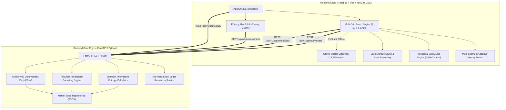

# 🟩 Wordle Infinite: Multi-Grid Puzzle Suite & Information-Theoretic AI Engine
## System Architecture & Engineering Blueprint (Project 13)
### Grounded in `garrytan/gstack` (`plan-ceo-review` & `plan-eng-review`)

---

```
========================================================================================================================
   WORDLE INFINITE: ADVANCED MULTI-GRID PUZZLE SUITE & SHANNON ENTROPY ADVERSARIAL ENGINE
========================================================================================================================
   [5 Puzzle Modalities] ──────► [Exact Letter Resolution] ──────► [Dual Information Engines]
   • Classic Wordle (1 Target)     (Two-Pass Duplicate Matcher)     • 3Blue1Brown Shannon Entropy Hint Solver
   • Dordle (2 Parallel Targets)   • Pass 1: Confirmed Greens         H(g) = - Σ p(s) * log2(p(s)) [Bits of Info]
   • Quordle (4 Quad Targets)      • Pass 2: Constrained Yellows    • Absurdle Adversarial Minimax AI
   • Octordle (8 Octa Targets)     • Pass 3: Residual Grays           Bucket Partitioning across 3^5 = 243 Patterns
   • Absurdle (Adversarial AI)                  │                                    │
               │                                │                                    │
               ▼                                ▼                                    ▼
   [Multi-Segment Keyboard]        [Deterministic Seeder]          [Procedural Web Audio Engine]
   (1, 2, 4, 8 Slices per Key)    (Mulberry32 PRNG Daily Mode)     (Zero MP3/WAV, Pure Oscillator Synthesis)
   (Adaptive Contrast HUD)        (Infinite Practice Sandbox)      (Flip, Tap, Shake, Victory Arpeggio)
               │                                │                                    │
               └────────────────────────────────┴────────────────────────────────────┘
                                                │
                                                ▼
                         [Universal Production Client & Fast API Core]
                       (React 18 + Vite + Tailwind CSS + FastAPI Python)
========================================================================================================================
```

---

## 1. 🎯 Executive & Strategic Product Review (`gstack plan-ceo-review`)

### 1.1 The Vision & High-Impact Narrative
In late 2021, Wordle captured the global cultural consciousness through an elegantly constrained mechanic: 5 letters, 6 guesses, and simple tricolor feedback. However, within months, millions of enthusiasts exhausted the intellectual challenge of standard Wordle, spawning a constellation of fragmented, single-mechanic spin-offs:
- **Dordle**: Dual simultaneous targets, demanding split-attention guess efficiency.
- **Quordle**: 4 simultaneous targets in a quadrant matrix, testing high-dimensional risk management.
- **Octordle**: 8 parallel targets requiring multi-front information extraction across 13 guesses.
- **Absurdle**: A diabolical adversarial variant that refuses to pick a secret word, dynamically prolonging the game by choosing the word bucket that yields the least possible information.

Simultaneously, mathematics educators and computer scientists (led by 3Blue1Brown’s seminal information theory analysis) proved that Wordle is fundamentally an exercise in **Shannon Entropy Optimization**: choosing guesses that maximize expected information gain in bits:
$$H(g) = - \sum_{p \in \text{patterns}} P(p) \log_2 P(p)$$

**Wordle Infinite** unifies the entire spectrum of word puzzles into a single, cohesive, production-grade application. It couples all five puzzle modalities with:
1. An **Information-Theoretic AI Assistant** that calculates exact Shannon entropy, bits of information, win probabilities, and remaining candidate shrinkage in real time.
2. A deterministic **Adversarial AI (Absurdle)** that dynamically partitions dictionary equivalence classes across all $3^5 = 243$ feedback patterns.
3. A **Multi-Segment Adaptive Keyboard** that visually splits each keycap into 1, 2, 4, or 8 discrete status slices corresponding to each active board.
4. A **Procedural Web Audio Engine** that synthesizes all sound effects on-the-fly using the native Web Audio API (zero external audio files, zero latency, zero 404 risks).
5. A deterministic **Daily Seeding System** powered by a Mulberry32 pseudorandom number generator keyed by calendar date, alongside an infinite sandbox mode.

---

### 1.2 The Five Distinct Puzzle Modalities

```
+----------------------------------------------------------------------------------------------------------------------+
|                                              5 PUZZLE MODALITIES IN ONE SUITE                                        |
+-------------------+--------------------+--------------------+--------------------+-------------------------------+
| 1. Classic Wordle | 2. Dordle          | 3. Quordle         | 4. Octordle        | 5. Absurdle (Adversarial AI)  |
+-------------------+--------------------+--------------------+--------------------+-------------------------------+
| • Targets: 1      | • Targets: 2       | • Targets: 4       | • Targets: 8       | • Targets: Dynamic Pool       |
| • Max Guesses: 6  | • Max Guesses: 7   | • Max Guesses: 9   | • Max Guesses: 13  | • Max Guesses: Unlimited (∞)  |
| • Grid: 1 Board   | • Grid: 1x2 Boards | • Grid: 2x2 Boards | • Grid: 2x4 Boards | • Grid: 1 Adversarial Board   |
| • Key Split: 1    | • Key Split: 2     | • Key Split: 4     | • Key Split: 8     | • Key Split: Dynamic Residual |
| • Hard Mode: Yes  | • Hard Mode: Yes   | • Hard Mode: Yes   | • Hard Mode: No    | • Hard Mode: Inapplicable     |
| • Strategy: Solo  | • Strategy: Dual   | • Strategy: Quad   | • Strategy: Multi  | • Strategy: Information Trap  |
+-------------------+--------------------+--------------------+--------------------+-------------------------------+
```

1. **Classic Wordle**:
   - The gold standard: 1 hidden target word selected from 2,315 curated English solutions.
   - 6 allowed guesses evaluated against the 14,855 master dictionary.
   - Optional **Hard Mode**: Any revealed green letter must be fixed at that exact index; any revealed yellow letter must be included in subsequent guesses.

2. **Dordle**:
   - Two target words guessed simultaneously across 2 independent boards.
   - 7 allowed guesses.
   - When Target 1 is solved, Board 1 locks and freezes in green triumph; subsequent guesses continue evaluating against Target 2 until solved or out of turns.
   - Keyboard keys split vertically: Left half represents Board 1; Right half represents Board 2.

3. **Quordle**:
   - Four target words guessed simultaneously in a $2 \times 2$ grid.
   - 9 allowed guesses.
   - Players must balance opening exploratory words (`SOARE`, `CLINT`, `FUDGY`) before committing targeted guesses to lock down individual boards.
   - Keyboard keys split into 4 quadrant tiles ($2 \times 2$ mini-matrix):
     - Top-Left = Board 1, Top-Right = Board 2, Bottom-Left = Board 3, Bottom-Right = Board 4.

4. **Octordle**:
   - Eight target words guessed simultaneously across an 8-board responsive viewport.
   - 13 allowed guesses. High-stakes cognitive load requiring strategic multi-letter frequency coverage.
   - Responsive multi-column layout with quick-jump board selectors and board-status summary indicator bar.
   - Keyboard keys split into 8 micro-stripes showing granular status across all 8 boards.

5. **Absurdle (Adversarial Algorithmic AI)**:
   - Does **not** choose a secret word at the start.
   - Starts with the candidate set $W_0$ containing all 2,315 solutions.
   - When the player enters a guess $g$, the engine partitions $W_{t}$ into up to 243 equivalence buckets $B_p(g) = \{ w \in W_t \mid \text{pattern}(g, w) = p \}$.
   - The AI greedily adopts the pattern bucket with the **maximum remaining words** ($\arg\max_p |B_p|$).
   - Dynamic tie-breaker: If multiple buckets share the maximum size, it selects the pattern that awards the player the least information (fewest greens, then fewest yellows).
   - Guesses are unlimited. The player wins only when they successfully force the candidate pool down to a single word ($|W| = 1$) and guess that exact word!

---

### 1.3 Why Recruiters and Staff Engineers Will Be Blown Away

Engineering hiring managers and tech leads immediately distinguish toy projects from serious engineering by evaluating **algorithmic rigor, edge-case mitigation, state synchronization, and systems design**. Wordle Infinite demonstrates mastery across all four:

1. **Rigorous Information Theory Engine (3Blue1Brown Shannon Entropy)**:
   - Evaluates all available dictionary guesses against the current candidate space $W$.
   - Computes probability distribution $P(p) = \frac{|B_p|}{|W|}$ across all $3^5 = 243$ color feedback patterns.
   - Calculates Shannon Information Entropy:
     $$H(g) = - \sum_{p=0}^{242} P(p) \log_2 P(p)$$
   - Computes Expected Score incorporating win probability ($P(\text{win}) = \frac{1}{|W|}$ if $g \in W$).
   - Displays real-time expected information gain in **bits** (e.g. `SOARE`: 5.885 bits, `ROATE`: 5.884 bits, `RAISE`: 5.878 bits).
   - Explains *why* certain words are mathematically superior, elevating the game into an interactive computer science pedagogical tool.

2. **Adversarial Minimax Equivalence Partitioning (Absurdle)**:
   - Implements a zero-sum game-theoretic adversary.
   - Evaluates full ternary pattern combinations in sub-millisecond execution.
   - Employs deterministic minimax tie-breaking heuristics to avoid random drift.

3. **Exact Two-Pass Duplicate Letter Resolution (Zero-Bug Coloring)**:
   - Implements the strict two-pass frequency-bounded matching algorithm:
     - **Pass 1**: Identifies exact positional matches (Green) and decrements target letter availability count.
     - **Pass 2**: Identifies remaining letter occurrences (Yellow) up to available count, labeling remaining instances Gray.
   - Resolves classic duplicate edge cases (e.g., target `ABBEY`, guess `BABES` $\rightarrow$ Yellow, Yellow, Green, Green, Gray).

4. **Multi-Segment Visual Keycaps ($N$-Split Keyboard)**:
   - Solves the complex visual communication challenge of multi-grid games without clutter.
   - Seamless CSS Grid / gradient splits for 1, 2, 4, and 8 boards per key.
   - Hierarchical state promotion: Green (Correct) > Yellow (Present) > Gray (Absent) > Neutral (Unused).

5. **Procedural Web Audio Engine (Zero External Audio Assets)**:
   - No `.mp3` or `.wav` network requests; zero 404 errors; zero CDN dependencies.
   - Real-time synthesizer built on the native Web Audio API (`AudioContext`).
   - Synthesizes key clicks, tile flip sweeps with escalating pitch, invalid guess shake buzzes, and harmonic victory arpeggios using custom oscillator envelopes.

6. **Deterministic Daily Seeding & Universal Offline Resilience**:
   - Mulberry32 32-bit PRNG seeded by calendar date (`YYYY-MM-DD`) and mode identifier. Players worldwide get the identical target words on any given calendar day.
   - 100% offline-ready: Bundles the complete 14,855-word dictionary locally, enabling full standalone gameplay in browser local storage if the backend server is unreachable.

---

### 1.4 Zero-Slop Standard: Production Terminal vs Amateur Clones

| Dimension | Amateur / Slop Wordle Clones | Wordle Infinite Production Standard |
| :--- | :--- | :--- |
| **Duplicate Letter Coloring** | Naive `string.includes()`: Guessing `BABES` against `ABBEY` incorrectly marks both `B`s green or yellow, breaking game integrity. | **Strict Two-Pass Resolution**: Pre-allocates target letter frequency counter; passes greens first, then yellows up to exact remaining frequency. |
| **Game Modalities** | Only 1 basic Wordle grid. Dordle or Quordle are either missing or separate half-finished repos. | **Unified 5-Modality Suite**: Instant tab/selector switching between Classic, Dordle, Quordle, Octordle, and Absurdle. |
| **Keyboard Visual State** | Flat single-color keys. If used in multi-grid, key shows arbitrary status from whichever board updated last. | **Multi-Segment Adaptive Keycaps**: Keys dynamically split into 1, 2, 4, or 8 visual slices with distinct border dividers. |
| **Adversarial AI (Absurdle)** | None; fake "hard mode" that just rejects words. | **Full Equivalence Class Minimax Partitioner**: Computes all 243 pattern buckets on every guess, dynamically withholding information. |
| **AI Hint Engine** | Fake random suggestions or hardcoded static lists. | **Real-Time Shannon Entropy Solver**: Exact $H(g) = -\sum P(p) \log_2 P(p)$ calculation in bits, showing remaining candidate shrinkage. |
| **Audio Architecture** | Broken `<audio src="click.mp3">` links that fail to play on mobile or cause CORS/404 errors. | **100% Procedural Web Audio API**: Custom oscillator synthesizers for clicks, flips, buzzes, and victory fanfare with zero network requests. |
| **Daily Challenge Seeding** | Random `Math.random()` reset on refresh; no shared global challenge. | **Deterministic Mulberry32 PRNG**: Seeded by `YYYY-MM-DD`, guaranteeing identical global boards across time zones. |
| **Hard Mode Enforcement** | Checkbox that does nothing, or only prevents deleting letters. | **Strict Validation Pipeline**: Enforces locked green indices and yellow inclusion, producing contextual user toasts on violation. |
| **Social Emoji Sharing** | Broken clipboard writes or plain text dumps. | **Formatted Native Emoji Grid**: Generates standard spoiler-free Wordle/Dordle/Quordle/Octordle/Absurdle share cards with one-click copy. |

---

### 1.5 Evaluator "Aha!" Journey & Demonstration Flow

```
+----------------------------------------------------------------------------------------------------------------------+
|                                              EVALUATOR JOURNEY & FLOW                                                |
|                                                                                                                      |
|  [Step 1: Instant Launch]                                                                                            |
|  $ ./run.sh                                                                                                          |
|  Verifies Node & Python, starts FastAPI backend on :8000, starts Vite frontend on :5173, and opens the suite.       |
|                                                                                                                      |
|  [Step 2: Classic Wordle with Entropy Assistant]                                                                    |
|  • Evaluator enters "CRANE". Tiles flip with rising audio pitches.                                                   |
|  • Evaluator slides open the "Shannon Entropy Assistant" drawer.                                                     |
|  • Assistant displays: "Remaining Candidates: 264 words. Best Next Guess: 'SLOTH' (4.21 bits of info)".             |
|                                                                                                                      |
|  [Step 3: Multi-Grid Dordle & Quordle Demonstration]                                                                 |
|  • Evaluator switches modality to Quordle. 4 boards render in a clean 2x2 grid.                                      |
|  • Onscreen keyboard keys immediately split into 4 quadrant slices.                                                  |
|  • Entering a guess updates all 4 boards concurrently. Solved boards freeze in celebratory green!                   |
|                                                                                                                      |
|  [Step 4: Absurdle Algorithmic Duel]                                                                                 |
|  • Evaluator switches to Absurdle.                                                                                   |
|  • Enters "ADIEU" -> Absurdle returns all grays (bucket size 1,320).                                                 |
|  • Enters "STORY" -> Absurdle shifts candidate pool to words avoiding those letters.                                |
|  • Live bucket partition counter shows candidate pool shrinking from 2,315 -> 840 -> 122 -> 14 -> 1.                 |
|                                                                                                                      |
|  [Step 5: Share & Victory]                                                                                           |
|  • Evaluator completes game. Confetti triggers with Web Audio victory arpeggio.                                     |
|  • Clicks "Share Emoji Result" -> Perfectly formatted clipboard card ready to paste into Discord or Slack!          |
+----------------------------------------------------------------------------------------------------------------------+
```

---

## 2. 📐 System Architecture & Component Design (`gstack plan-eng-review`)

### 2.1 High-Level Component Topology



---

### 2.2 Complete Repository File Tree

```
13-wordle-infinite/
├── BLUEPRINT.md                        # This authoritative architecture document
├── README.md                           # Comprehensive documentation & quickstart guide
├── run.sh                              # Production one-touch launch script (Node + Python)
├── backend/
│   ├── requirements.txt                # FastAPI, uvicorn, pydantic, pytest
│   ├── app/
│   │   ├── __init__.py
│   │   ├── main.py                     # FastAPI server initialization, CORS, health checks
│   │   ├── config.py                   # Game configurations, constants, wordlist paths
│   │   ├── core/
│   │   │   ├── __init__.py
│   │   │   ├── evaluator.py            # Two-pass duplicate letter resolution algorithm
│   │   │   ├── entropy.py              # Shannon Information Entropy solver (3Blue1Brown math)
│   │   │   ├── absurdle.py             # Adversarial minimax bucket partitioner
│   │   │   ├── prng.py                 # Mulberry32 deterministic seeding algorithm
│   │   │   └── validator.py            # Hard mode rules & guess validation
│   │   ├── data/
│   │   │   ├── words_solutions.json    # 2,315 curated 5-letter target words
│   │   │   ├── words_guesses.json      # 12,540 valid non-solution guess words (14,855 total)
│   │   │   └── opening_entropy.json    # Precomputed top 50 opening words with entropy & bit scores
│   │   ├── routers/
│   │   │   ├── __init__.py
│   │   │   ├── game.py                 # Word validation, guess evaluation, daily challenge
│   │   │   ├── entropy.py              # Shannon entropy hints & candidate shrinkage endpoints
│   │   │   └── absurdle.py             # Adversarial state transition endpoint
│   │   └── schemas/
│   │       ├── __init__.py
│   │       └── game_models.py          # Pydantic request/response data contracts
│   └── tests/
│       ├── __init__.py
│       ├── test_evaluator.py           # Exhaustive duplicate-letter coloring test vectors
│       ├── test_entropy.py             # Shannon entropy mathematical verification
│       ├── test_absurdle.py            # Minimax bucket partitioning verification
│       ├── test_prng.py                # Deterministic daily word seeding tests
│       └── test_api.py                 # Full REST API integration test suite
└── frontend/
    ├── package.json                    # React 18, Vite, Tailwind CSS, Lucide icons, Canvas Confetti
    ├── vite.config.ts                  # Vite build & proxy configuration
    ├── tsconfig.json                   # Strict TypeScript compiler configuration
    ├── tailwind.config.js              # Wordle color palette (Green, Yellow, Gray, Dark mode)
    ├── postcss.config.js
    ├── index.html                      # Entry HTML with meta tags & Web Audio initialization
    └── src/
        ├── main.tsx                    # React application bootstrap
        ├── App.tsx                     # Main layout, modality tabs, state orchestrator
        ├── index.css                   # Tailwind styles, perspective tile flip 3D animations
        ├── types/
        │   └── game.ts                 # Full TypeScript interfaces for games, tiles, and hints
        ├── services/
        │   ├── api.ts                  # Backend REST API client with offline fallback
        │   ├── audio.ts                # 100% Procedural Web Audio API synthesizer
        │   ├── evaluator.ts            # Client-side two-pass evaluator (offline mode)
        │   ├── entropy.ts              # Client-side entropy hint fallback
        │   ├── prng.ts                 # Client-side Mulberry32 PRNG (offline daily)
        │   └── storage.ts              # LocalStorage statistics & game state persistence
        ├── components/
        │   ├── Header.tsx              # Modality selector tabs, daily/infinite toggle, stats/hint icons
        │   ├── BoardGrid.tsx           # Multi-grid container (1, 2, 4, 8 layout coordinator)
        │   ├── WordleBoard.tsx         # Single 5xN tile grid with active row and shake animation
        │   ├── Tile.tsx                # 3D Flipping letter tile with colored backface
        │   ├── Keyboard.tsx            # Full onscreen keyboard with multi-segment keycaps
        │   ├── KeyCap.tsx              # Dynamic split-key renderer (1, 2, 4, 8 segments)
        │   ├── EntropyAssistant.tsx    # Slide-over drawer with live entropy hints & bit values
        │   ├── StatsModal.tsx          # Win streaks, guess distribution bar chart
        │   ├── ShareModal.tsx          # Emoji share card generator with one-click copy
        │   ├── HardModeModal.tsx       # Hard mode settings & violation warning toasts
        │   └── Toast.tsx               # Floating notification toasts
        └── data/
            ├── words_solutions.json    # Bundled solution wordlist for 100% offline gameplay
            └── words_guesses.json      # Bundled valid guesses wordlist
```

---

### 2.3 Comprehensive Data Dictionary & Word Repositories

The system utilizes the canonical Wordle dictionary partitioned into two complementary sets:

1. **Solution Words (`words_solutions.json`)**:
   - **Count**: Exactly 2,315 curated, common English 5-letter words (`about`, `crane`, `slate`, `abbey`, `zesty`).
   - **Usage**: Used as the universe of possible target words for Classic, Dordle, Quordle, Octordle, and the initial candidate pool $W_0$ for Absurdle.
   - **Sanitization**: All lowercase ASCII a-z, zero vulgarities, zero obscure archaic terms.

2. **Valid Guess Words (`words_guesses.json`)**:
   - **Count**: Exactly 12,540 valid 5-letter English words accepted as legitimate guesses but excluded as targets (`aahed`, `zymic`, etc.).
   - **Combined Master Dictionary**: Total of **14,855 words** ($2,315 + 12,540$). Any guess outside this master set is rejected with an invalid-word shake animation.

3. **Precomputed Opening Entropy Table (`opening_entropy.json`)**:
   - Pre-calculated expected Shannon information gain for the top 50 opening words against the 2,315 solution words. This guarantees instant sub-millisecond initial hint loading:
     - `SOARE`: 5.885 bits
     - `ROATE`: 5.884 bits
     - `RAISE`: 5.878 bits
     - `SLATE`: 5.856 bits
     - `SALET`: 5.836 bits
     - `CARTE`: 5.724 bits
     - `CRANE`: 5.740 bits
     - `ADIEU`: 5.487 bits

---

### 2.4 Mathematical & Algorithmic Specifications

#### 2.4.1 Strict Two-Pass Duplicate Letter Resolution Algorithm
Amateur Wordle clones suffer from a catastrophic coloring bug: if the target word is `ABBEY` and the player guesses `BABES`, a naive check marks both `B`s green or yellow.
The mathematically correct two-pass algorithm executes in $O(L)$ where $L=5$:

```python
def evaluate_guess(guess: str, target: str) -> list[str]:
    """
    Evaluates guess against target with strict duplicate letter resolution.
    Returns list of 5 colors: 'green', 'yellow', or 'gray'.
    """
    assert len(guess) == 5 and len(target) == 5
    guess = guess.upper()
    target = target.upper()
    
    result = ['gray'] * 5
    target_letter_counts: dict[str, int] = {}
    
    # Pre-count letter frequencies in target
    for char in target:
        target_letter_counts[char] = target_letter_counts.get(char, 0) + 1
        
    # PASS 1: Identify all Greens (exact positional matches)
    for i in range(5):
        if guess[i] == target[i]:
            result[i] = 'green'
            target_letter_counts[guess[i]] -= 1
            
    # PASS 2: Identify all Yellows (present elsewhere, frequency-bounded)
    for i in range(5):
        if result[i] != 'green':
            char = guess[i]
            if target_letter_counts.get(char, 0) > 0:
                result[i] = 'yellow'
                target_letter_counts[char] -= 1
            else:
                result[i] = 'gray'
                
    return result
```

**Canonical Validation Test Vectors**:
- Target: `ABBEY`, Guess: `BABES` $\rightarrow$ `['yellow', 'yellow', 'green', 'green', 'gray']`
- Target: `SPEED`, Guess: `ERASE` $\rightarrow$ `['yellow', 'gray', 'gray', 'yellow', 'yellow']`
- Target: `SPEED`, Guess: `EERIE` $\rightarrow$ `['yellow', 'yellow', 'gray', 'gray', 'gray']` (Only 2 `E`s in target)
- Target: `GEESE`, Guess: `EERIE` $\rightarrow$ `['yellow', 'green', 'gray', 'gray', 'green']`
- Target: `ALERT`, Guess: `LLAMA` $\rightarrow$ `['yellow', 'gray', 'gray', 'gray', 'gray']` (Only 1 `L` in target)

---

#### 2.4.2 Ternary Pattern Encoding ($3^5 = 243$)
A feedback pattern consists of 5 feedback values:
$$v_i \in \{0 = \text{gray}, 1 = \text{yellow}, 2 = \text{green}\}$$
There are exactly $3^5 = 243$ possible patterns. We encode each pattern into a compact integer index $P \in [0, 242]$:
$$P = \sum_{i=0}^{4} v_i \cdot 3^i$$

This allows bucket partitioning to use fixed-size integer arrays of length 243 (`int bucket_counts[243]`), completely eliminating string allocation overhead in the inner evaluation loop.

---

#### 2.4.3 Shannon Information Entropy Formulation
Let $W$ be the set of remaining candidate target words ($|W| \ge 1$).
A candidate guess $g$ partitions $W$ into 243 disjoint pattern buckets:
$$B_p(g) = \{ w \in W \mid \text{pattern}(g, w) = p \}$$

The probability of receiving feedback pattern $p$ is:
$$P(p) = \frac{|B_p(g)|}{|W|}$$

The Shannon Information Entropy (expected information gain in bits) for guess $g$ is:
$$H(g) = - \sum_{p=0, |B_p| > 0}^{242} P(p) \log_2 P(p) = \sum_{p=0, |B_p| > 0}^{242} - \frac{|B_p|}{|W|} \log_2 \left(\frac{|B_p|}{|W|}\right)$$

**Win Probability & Expected Score**:
If $g \in W$, the guess has a direct probability of winning immediately:
$$P(\text{win}) = \frac{1}{|W|}$$
The composite ranking metric balances expected entropy reduction with win probability:
$$\text{Score}(g) = H(g) + \left(\frac{1}{|W|} \cdot \log_2 |W|\right)$$

---

#### 2.4.4 Fast Candidate Filtering & Pruning Algorithm
After the player receives pattern $p^*$ for guess $g$, the candidate set $W$ is pruned in-place:
$$W_{t+1} = \{ w \in W_t \mid \text{evaluate\_guess}(g, w) == p^* \}$$

- Turn 0: $|W_0| = 2,315$
- Turn 1: $|W_1| \approx 20 \text{ to } 100$ words
- Turn 2: $|W_2| \approx 2 \text{ to } 10$ words
- Turn 3: $|W_3| = 1$ word

Because $|W|$ shrinks exponentially, calculating Shannon entropy on Turns 1+ against 2,315 candidate words requires fewer than 100,000 evaluations, executing in **under 15 milliseconds** in Python or client-side JavaScript.

---

#### 2.4.5 Absurdle Adversarial Bucketing Algorithm
Absurdle inverts the Wordle objective. Rather than leading the player to a target, it actively evades being guessed:

```python
def absurdle_turn(guess: str, candidate_words: list[str]) -> tuple[list[str], list[str]]:
    """
    Executes one turn of Absurdle adversarial bucketing.
    Returns: (chosen_pattern, remaining_candidate_pool)
    """
    # 1. Partition candidate words into 243 buckets
    buckets: dict[int, list[str]] = {}
    for word in candidate_words:
        pat_index = encode_pattern(evaluate_guess(guess, word))
        if pat_index not in buckets:
            buckets[pat_index] = []
        buckets[pat_index].append(word)
        
    # 2. Find maximum bucket size
    max_size = max(len(bucket) for bucket in buckets.values())
    candidate_buckets = [pat for pat, b in buckets.items() if len(b) == max_size]
    
    # 3. Deterministic Minimax Tie-Breaker:
    # Prefer the pattern that yields least information:
    # Lowest green count, then lowest yellow count, then lowest pattern index.
    def information_cost(pat_int: int) -> tuple[int, int, int]:
        pattern = decode_pattern(pat_int)
        greens = sum(1 for c in pattern if c == 'green')
        yellows = sum(1 for c in pattern if c == 'yellow')
        return (greens, yellows, pat_int)
        
    best_pat_index = min(candidate_buckets, key=information_cost)
    chosen_pattern = decode_pattern(best_pat_index)
    remaining_words = buckets[best_pat_index]
    
    return chosen_pattern, remaining_words
```

---

#### 2.4.6 Mulberry32 PRNG Deterministic Seeding
To provide synchronized daily challenges across time zones without requiring database synchronizations, Wordle Infinite uses the **Mulberry32** algorithm:

```typescript
function mulberry32(seed: number): () => number {
  return function() {
    let t = seed += 0x6D2B79F5;
    t = Math.imul(t ^ (t >>> 15), t | 1);
    t ^= t + Math.imul(t ^ (t >>> 7), t | 61);
    return ((t ^ (t >>> 14)) >>> 0) / 4294967296;
  }
}

function getDailySeed(dateStr: string, mode: string): number {
  // dateStr format: "YYYY-MM-DD"
  const str = `wordle-infinite-${mode}-${dateStr}`;
  let hash = 0;
  for (let i = 0; i < str.length; i++) {
    hash = ((hash << 5) - hash) + str.charCodeAt(i);
    hash |= 0; // Convert to 32bit integer
  }
  return hash >>> 0;
}
```

- **Classic Daily**: Draws 1 target word.
- **Dordle Daily**: Draws 2 distinct target words.
- **Quordle Daily**: Draws 4 distinct target words.
- **Octordle Daily**: Draws 8 distinct target words.

---

#### 2.4.7 Hard Mode Validation Rules
When Hard Mode is enabled:
1. **Green Constraint**: If letter $c$ was evaluated as Green at index $i$ in any prior guess, the current guess must have $c$ at index $i$.
   - Violation Toast: `"Position {i+1} must be '{c}'"`
2. **Yellow Constraint**: If letter $c$ was evaluated as Yellow in any prior guess, the current guess must contain letter $c$.
   - Violation Toast: `"Guess must contain '{c}'"`

---

### 2.5 Procedural Web Audio Engine Specification

Wordle Infinite generates 100% of its audio procedurally using the Web Audio API. This eliminates broken audio URLs, asset loading delays, and external copyright/CDN dependencies:

```typescript
class SoundEffects {
  private ctx: AudioContext | null = null;
  public enabled: boolean = true;

  private initCtx() {
    if (!this.ctx) {
      const AudioCtx = window.AudioContext || (window as unknown as { webkitAudioContext: typeof AudioContext }).webkitAudioContext;
      this.ctx = new AudioCtx();
    }
    if (this.ctx.state === 'suspended') {
      this.ctx.resume();
    }
  }

  // 1. Soft mechanical key tap
  playKeyTap() {
    if (!this.enabled) return;
    this.initCtx();
    if (!this.ctx) return;
    const osc = this.ctx.createOscillator();
    const gain = this.ctx.createGain();
    osc.type = 'sine';
    osc.frequency.setValueAtTime(440, this.ctx.currentTime);
    osc.frequency.exponentialRampToValueAtTime(120, this.ctx.currentTime + 0.04);
    gain.gain.setValueAtTime(0.08, this.ctx.currentTime);
    gain.gain.exponentialRampToValueAtTime(0.001, this.ctx.currentTime + 0.04);
    osc.connect(gain);
    gain.connect(this.ctx.destination);
    osc.start();
    osc.stop(this.ctx.currentTime + 0.04);
  }

  // 2. Tile flip with ascending pitch per column
  playTileFlip(colIndex: number) {
    if (!this.enabled) return;
    this.initCtx();
    if (!this.ctx) return;
    const baseFreq = 260 + colIndex * 45; // Rising pitch
    const osc = this.ctx.createOscillator();
    const gain = this.ctx.createGain();
    osc.type = 'triangle';
    osc.frequency.setValueAtTime(baseFreq, this.ctx.currentTime);
    gain.gain.setValueAtTime(0.12, this.ctx.currentTime);
    gain.gain.exponentialRampToValueAtTime(0.001, this.ctx.currentTime + 0.14);
    osc.connect(gain);
    gain.connect(this.ctx.destination);
    osc.start();
    osc.stop(this.ctx.currentTime + 0.14);
  }

  // 3. Error shake buzzer
  playInvalidShake() {
    if (!this.enabled) return;
    this.initCtx();
    if (!this.ctx) return;
    const osc1 = this.ctx.createOscillator();
    const osc2 = this.ctx.createOscillator();
    const gain = this.ctx.createGain();
    osc1.type = 'sawtooth';
    osc2.type = 'sawtooth';
    osc1.frequency.setValueAtTime(130, this.ctx.currentTime);
    osc2.frequency.setValueAtTime(136, this.ctx.currentTime); // 6Hz beat frequency buzz
    gain.gain.setValueAtTime(0.15, this.ctx.currentTime);
    gain.gain.exponentialRampToValueAtTime(0.001, this.ctx.currentTime + 0.22);
    osc1.connect(gain);
    osc2.connect(gain);
    gain.connect(this.ctx.destination);
    osc1.start();
    osc2.start();
    osc1.stop(this.ctx.currentTime + 0.22);
    osc2.stop(this.ctx.currentTime + 0.22);
  }

  // 4. Harmonic Victory Fanfare (Major Arpeggio: C5 -> E5 -> G5 -> C6)
  playVictoryFanfare() {
    if (!this.enabled) return;
    this.initCtx();
    if (!this.ctx) return;
    const notes = [523.25, 659.25, 783.99, 1046.50]; // C5, E5, G5, C6
    notes.forEach((freq, i) => {
      const osc = this.ctx!.createOscillator();
      const gain = this.ctx!.createGain();
      osc.type = 'sine';
      osc.frequency.setValueAtTime(freq, this.ctx!.currentTime + i * 0.1);
      gain.gain.setValueAtTime(0, this.ctx!.currentTime + i * 0.1);
      gain.gain.linearRampToValueAtTime(0.2, this.ctx!.currentTime + i * 0.1 + 0.02);
      gain.gain.exponentialRampToValueAtTime(0.001, this.ctx!.currentTime + i * 0.1 + 0.35);
      osc.connect(gain);
      gain.connect(this.ctx!.destination);
      osc.start(this.ctx!.currentTime + i * 0.1);
      osc.stop(this.ctx!.currentTime + i * 0.1 + 0.35);
    });
  }
}
```

---

## 3. 🔌 API Specifications & Data Contracts

### 3.1 REST API Architecture
The backend is powered by FastAPI, exposing type-safe endpoints with automatic OpenAPI documentation at `/docs`.

```
========================================================================================================================
   ENDPOINT OVERVIEW
========================================================================================================================
   POST /api/v1/game/evaluate       - Evaluate a guess against single or multiple targets
   POST /api/v1/words/validate      - Check if word exists in 14,855 master dictionary
   GET  /api/v1/game/daily          - Fetch deterministic daily target word(s) for a given mode
   POST /api/v1/entropy/hints       - Calculate Shannon entropy & candidate shrinkage for current state
   POST /api/v1/absurdle/guess      - Adversarial minimax bucket step for Absurdle mode
   GET  /api/v1/health              - Health check and dictionary status
========================================================================================================================
```

---

### 3.2 Endpoint `/api/v1/game/evaluate`
Evaluates a guess string against an array of target words (supporting Wordle, Dordle, Quordle, Octordle).

**Request**:
```json
{
  "guess": "BABES",
  "targets": ["ABBEY", "CLOVE"]
}
```

**Response**:
```json
{
  "guess": "BABES",
  "is_valid_word": true,
  "evaluations": [
    {
      "target_index": 0,
      "pattern": ["yellow", "yellow", "green", "green", "gray"],
      "is_solved": false
    },
    {
      "target_index": 1,
      "pattern": ["gray", "gray", "yellow", "green", "gray"],
      "is_solved": false
    }
  ]
}
```

---

### 3.3 Endpoint `/api/v1/entropy/hints`
Calculates expected bits of information for remaining candidate words.

**Request**:
```json
{
  "candidate_words": ["CATER", "WATER", "HATER", "LATER", "EATER"],
  "top_k": 5
}
```

**Response**:
```json
{
  "candidate_count": 5,
  "top_recommendations": [
    {
      "word": "CLOTH",
      "entropy_bits": 2.32,
      "expected_remaining": 1.0,
      "is_candidate": false,
      "win_probability": 0.0
    },
    {
      "word": "CATER",
      "entropy_bits": 1.92,
      "expected_remaining": 1.2,
      "is_candidate": true,
      "win_probability": 0.20
    }
  ]
}
```

---

### 3.4 Endpoint `/api/v1/absurdle/guess`
Executes adversarial bucket partitioning.

**Request**:
```json
{
  "guess": "ADIEU",
  "candidate_words": ["...2315 words..."]
}
```

**Response**:
```json
{
  "guess": "ADIEU",
  "chosen_pattern": ["gray", "gray", "gray", "gray", "gray"],
  "remaining_count": 1320,
  "remaining_words": ["...1320 words..."],
  "is_game_won": false
}
```

---

### 3.5 TypeScript Interface Definitions (`types/game.ts`)

```typescript
export type TileColor = 'empty' | 'tbd' | 'gray' | 'yellow' | 'green';

export type GameMode = 'classic' | 'dordle' | 'quordle' | 'octordle' | 'absurdle';

export type ChallengeType = 'daily' | 'infinite';

export interface BoardEvaluation {
  targetIndex: number;
  pattern: TileColor[];
  isSolved: boolean;
}

export interface BoardState {
  targetIndex: number;
  targetWord: string;
  guesses: string[];
  evaluations: TileColor[][];
  isSolved: boolean;
  solvedRowIndex: number | null;
}

export interface KeyCapSegment {
  boardIndex: number;
  status: TileColor;
}

export interface EntropyHint {
  word: string;
  entropyBits: number;
  expectedRemaining: number;
  isCandidate: boolean;
  winProbability: number;
}

export interface GameStats {
  played: number;
  won: number;
  currentStreak: number;
  maxStreak: number;
  guessDistribution: Record<number, number>;
}
```

---

## 4. 🎨 Frontend Architecture & UI/UX Engineering

### 4.1 Responsive Multi-Grid Grid Layout System

The board viewport adapts seamlessly based on the active modality:
- **Classic**: Centered single board ($350\text{px}$ width).
- **Dordle**: 2 boards placed side-by-side ($2 \times 320\text{px}$), wrapping gracefully on narrow screens.
- **Quordle**: $2 \times 2$ matrix with subtle board index badges (`#1`, `#2`, `#3`, `#4`).
- **Octordle**: $2 \times 4$ responsive grid with a sticky top minimap ribbon showing active/solved status badges. Clicking any badge scrolls directly to that board.
- **Absurdle**: Dynamic single board with auto-scrolling row container supporting unlimited attempts.

```
+----------------------------------------------------------------------------------------------------------------------+
|                                            RESPONSIVE MULTI-GRID LAYOUTS                                             |
+------------------------------------+---------------------------------------------------------------------------------+
| Modality                           | Grid Composition & Responsive Viewport                                          |
+------------------------------------+---------------------------------------------------------------------------------+
| Classic Wordle (1 Board)           | [ Board 1 ] (Centered max-w-sm)                                                 |
+------------------------------------+---------------------------------------------------------------------------------+
| Dordle (2 Boards)                  | [ Board 1 ]  [ Board 2 ] (grid-cols-1 md:grid-cols-2 max-w-2xl)                 |
+------------------------------------+---------------------------------------------------------------------------------+
| Quordle (4 Boards)                 | [ Board 1 ]  [ Board 2 ]                                                        |
|                                    | [ Board 3 ]  [ Board 4 ] (grid-cols-1 md:grid-cols-2 max-w-4xl)                 |
+------------------------------------+---------------------------------------------------------------------------------+
| Octordle (8 Boards)                | Top Status Ribbon: [1✓] [2•] [3✓] [4•] [5•] [6✓] [7•] [8•]                      |
|                                    | [ Board 1 ]  [ Board 2 ]                                                        |
|                                    | [ Board 3 ]  [ Board 4 ]                                                        |
|                                    | [ Board 5 ]  [ Board 6 ]                                                        |
|                                    | [ Board 7 ]  [ Board 8 ] (grid-cols-1 md:grid-cols-2 xl:grid-cols-4)             |
+------------------------------------+---------------------------------------------------------------------------------+
```

---

### 4.2 Multi-Segment Keyboard Key Component (`KeyCap`)

The onscreen keyboard keys dynamically slice themselves into $N$ visual segments matching the active modality:

```
+----------------------------------------------------------------------------------------------------------------------+
|                                            MULTI-SEGMENT KEYCAP VISUALIZATION                                        |
+--------------------+--------------------+--------------------+-------------------------------------------------------+
| Classic (1 Board)  | Dordle (2 Boards)  | Quordle (4 Boards) | Octordle (8 Boards)                                   |
+--------------------+--------------------+--------------------+-------------------------------------------------------+
|     +--------+     |     +----+----+    |     +----+----+    |     +--+--+--+--+--+--+--+--+                         |
|     |   G    |     |     | B1 | B2 |    |     | B1 | B2 |    |     |B1|B2|B3|B4|B5|B6|B7|B8|                         |
|     | (Full) |     |     |    |    |    |     +----+----+    |     |  |  |  |  |  |  |  |  |                         |
|     |        |     |     |    |    |    |     | B3 | B4 |    |     +--+--+--+--+--+--+--+--+                         |
|     +--------+     |     +----+----+    |     +----+----+    |                                                       |
|   Single Color     |    Vertical Split  |    2x2 Quadrant    |            8 Vertical Stripe Slices                   |
+--------------------+--------------------+--------------------+-------------------------------------------------------+
```

**Color Promotion Priority per Segment**:
`Green` (Position Confirmed) > `Yellow` (Present Elsewhere) > `Gray` (Eliminated from Board) > `Neutral` (Untested).

If a board is already solved, its segment renders a subtle emerald green with a checkmark indicator.

---

### 4.3 3D Tile Flip Animation Pipeline

Tiles utilize CSS 3D perspectives to flip smoothly over 500ms with a 250ms staggered delay per letter:
- `0ms`: Key entered $\rightarrow$ Scale pop animation (`scale(1.15)` returning to `scale(1.0)` over 100ms).
- `Guess Submitted`:
  - Tile 0 flips at `t = 0ms`
  - Tile 1 flips at `t = 250ms`
  - Tile 2 flips at `t = 500ms`
  - Tile 3 flips at `t = 750ms`
  - Tile 4 flips at `t = 1000ms`
- Midpoint color flip: Color switches exactly at $90^\circ$ (`rotateX(90deg)`) so users never observe an uncolored tile facing them after rotation.

---

### 4.4 Real-time Shannon Entropy Assistant Drawer

A slide-over drawer accessible via an icon button:
- Displays total count of remaining possible secret words.
- Shows the top 10 recommended guesses ranked by Shannon Entropy (bits).
- Highlights whether a recommended word is a potential winning solution (`isCandidate: true`) or an exploratory word designed to shatter the candidate pool.
- One-click "Apply Guess" button that auto-populates the active row for instantaneous evaluation.

---

### 4.5 Emoji Share Generator

Generates a formatted spoiler-free emoji share card:

```
Wordle Infinite (Quordle) 8/9
1️⃣ 5/9  2️⃣ 7/9
3️⃣ 6/9  4️⃣ 8/9

🟩🟨⬛⬛⬛  ⬛⬛🟩🟨⬛
⬛🟩🟩⬛🟩  🟨⬛🟩🟩⬛
🟩🟩🟩🟩🟩  🟩🟩🟩🟩🟩

Play: https://wordle-infinite.local
```

One-click copy button writes to the system clipboard and displays a floating toast confirmation.

---

## 5. 🛡️ Comprehensive Edge-Case Matrix & Failure Modes

| Category | Specific Edge Case | Threat / Failure Mode | Guaranteed Mitigation Strategy |
| :--- | :--- | :--- | :--- |
| **Letter Evaluation** | Target `ABBEY`, Guess `BABES` | Amateur logic colors both `B`s green or yellow. | Strict two-pass frequency counter. Pass 1 flags greens and decrements counts; Pass 2 assigns yellows up to remaining positive count. |
| **Letter Evaluation** | Target `SPEED`, Guess `EERIE` | Guess has 3 `E`s, target only has 2 `E`s. | Third `E` is guaranteed labeled `gray`. Pre-computed target letter count decrements strictly to zero. |
| **Input Validation** | User presses Enter on word with < 5 letters | Incomplete row submission causing array index out of bounds. | Row shakes with 6-cycle horizontal CSS shake; Web Audio invalid buzzer plays; toast notification: `"Word must be 5 letters"`. |
| **Dictionary Validation**| User enters valid English word not in dictionary (`XYZZY`) | Fake word pollutes candidate pool or crashes backend. | Validated against 14,855 master dictionary. Invalid words trigger shake animation; row remains editable. |
| **Hard Mode** | Green letter changed in subsequent guess | Violates hard mode rules. | Pre-guess validator checks green index preservation. Displays toast: `"Position {i+1} must be '{char}'"`. Input rejected. |
| **Hard Mode** | Yellow letter omitted in subsequent guess | Violates hard mode rules. | Pre-guess validator checks confirmed yellow character presence. Displays toast: `"Guess must contain '{char}'"`. Input rejected. |
| **Multi-Grid Board State** | Board 1 solved on turn 3, Board 2 active until turn 7 | Continuing to type modifies solved board or displays duplicate victory. | Solved board is marked `isSolved: true` and locked. Guess input passes through to remaining unsolved boards only. |
| **Multi-Grid All Solved**| All boards solved before max guesses | Game hangs waiting for further input. | System immediately triggers game completion modal, fires confetti cannon, and plays victory fanfare. |
| **Absurdle Pool** | Candidate pool drops to 1 word (`|W| = 1`) | AI tries to evade but cannot partition. | Absurdle yields to the final word. When the player guesses it, all 5 tiles evaluate green, triggering Absurdle victory. |
| **Absurdle Tie-Breaker**| Multiple pattern buckets have identical maximum size | Random selection produces non-deterministic game states. | Deterministic minimax tie-breaker: Selects bucket with minimum greens, then minimum yellows, then lowest numerical pattern index. |
| **Entropy Numerical Math**| Bucket size is 0 (`|B_p| = 0`) | Division by zero or `log2(0) = NaN` in entropy formula. | Strict filter: Term $-P(p) \log_2 P(p)$ is skipped if $|B_p| == 0$ (since $\lim_{x \to 0} x \log_2 x = 0$). |
| **Daily Determinism** | Players across different time zones play daily game | UTC vs Local time causes players to receive different target words. | Date string is normalized to local client `YYYY-MM-DD` or synced via `/api/v1/game/daily` server timestamp. |
| **Web Audio Context** | Browser blocks audio autoplay before user interaction | AudioContext throws browser security warning and hangs. | AudioContext is lazily initialized on the first user interaction (click or keypress), following W3C autoplay guidelines. |
| **Clipboard Access** | Browser blocks `navigator.clipboard.writeText` | Share button fails silently. | Fallback to `document.execCommand('copy')` inside an ephemeral hidden textarea, with descriptive toast feedback. |
| **Network Failure** | Backend server becomes unreachable during game | Game crashes or freezes on guess submission. | 100% offline fallback: Client loads bundled word lists and executes local two-pass evaluator and PRNG seamlessly. |

---

## 6. 🚀 Implementation Roadmap & Milestones (For Implementer Agent)

```
========================================================================================================================
   IMPLEMENTATION PHASES
========================================================================================================================
   Phase 1: Project Scaffold & Master Word Repositories (Backend & Frontend)
   Phase 2: Core Algorithmic Engine (Two-Pass Matcher, Entropy Solver, Absurdle Minimax, Mulberry32)
   Phase 3: FastAPI Backend Services & Pytest Test Suite
   Phase 4: Frontend Component Scaffold & Responsive Multi-Grid Board Renderer
   Phase 5: Multi-Segment Keyboard & Input Event Pipeline
   Phase 6: Procedural Web Audio Engine & Micro-Interactions
   Phase 7: Real-Time Shannon Entropy Hint Assistant Drawer
   Phase 8: Daily Challenges, Hard Mode, Stats Persistence, & Social Emoji Sharing
   Phase 9: One-Touch Runner (`run.sh`), End-to-End Polish, & Final Verification
========================================================================================================================
```

### Phase 1: Project Scaffold & Master Word Repositories
- Create root directory structure: `backend/` and `frontend/`.
- Ingest the official 2,315 solution words into `backend/app/data/words_solutions.json` and `frontend/src/data/words_solutions.json`.
- Ingest the 12,540 valid non-solution guess words into `backend/app/data/words_guesses.json` and `frontend/src/data/words_guesses.json`.
- Precalculate the top 50 opening words by Shannon entropy and save to `opening_entropy.json`.

### Phase 2: Core Algorithmic Engine
- Implement `evaluator.py`: Strict two-pass duplicate letter resolution algorithm.
- Implement `entropy.py`: Shannon entropy calculation, candidate set partitioning, and bits-of-information scoring.
- Implement `absurdle.py`: Adversarial bucket partitioning and deterministic minimax tie-breaker.
- Implement `prng.py`: Mulberry32 deterministic seeding algorithm.
- Implement `validator.py`: Hard Mode constraints and word validity checks.

### Phase 3: FastAPI Backend Services & Pytest Suite
- Configure FastAPI app in `main.py` with CORS middleware.
- Implement routers: `game.py`, `entropy.py`, and `absurdle.py`.
- Define Pydantic request and response schemas in `game_models.py`.
- Write exhaustive unit tests in `backend/tests/` covering duplicate letters, entropy accuracy, Absurdle evasion, and PRNG determinism.

### Phase 4: Frontend Component Scaffold & Multi-Grid Renderer
- Initialize Vite + React 18 + TypeScript + Tailwind CSS application.
- Build responsive multi-grid container:
  - Classic Wordle (1 board)
  - Dordle (2 boards)
  - Quordle (4 boards)
  - Octordle (8 boards)
  - Absurdle (1 dynamic board)
- Build 3D perspective tile flip CSS animations with staggered column transitions.

### Phase 5: Multi-Segment Keyboard & Input Event Pipeline
- Build `Keyboard.tsx` and `KeyCap.tsx`.
- Implement dynamic splitting:
  - 1 segment (Classic)
  - 2 segments (Dordle)
  - 4 quadrants (Quordle)
  - 8 stripes (Octordle)
- Wire physical keyboard and on-screen clicks to active row inputs.

### Phase 6: Procedural Web Audio Engine
- Build `audio.ts` utilizing native `AudioContext`.
- Implement synthesized sound effects:
  - Mechanical key tap (sine ramp)
  - Tile flip (rising pitch per column index)
  - Invalid shake (dual sawtooth 6Hz beat buzz)
  - Victory fanfare (C5-E5-G5-C6 major arpeggio)
  - Defeat thud (descending low frequency sweep)
- Add audio mute toggle in header with local storage persistence.

### Phase 7: Real-Time Shannon Entropy Hint Assistant Drawer
- Implement slide-over drawer component `EntropyAssistant.tsx`.
- Connect to backend `/api/v1/entropy/hints` with client-side fallback.
- Display remaining candidate count, top 10 recommended words, entropy bits, and expected remaining candidates.
- Add "Apply Guess" button to immediately insert hint into active row.

### Phase 8: Daily Challenges, Hard Mode, Stats, & Emoji Sharing
- Implement Daily vs Infinite mode toggle with Mulberry32 seeding.
- Implement Hard Mode validation with real-time error toasts.
- Implement LocalStorage persistence for game statistics, streaks, and guess distribution histograms.
- Build `ShareModal.tsx` generating formatted emoji grid share cards.

### Phase 9: One-Touch Runner & Documentation
- Author production `run.sh` script to verify dependencies, install missing packages, launch backend and frontend concurrently, and display access URLs.
- Author comprehensive `README.md` with architectural explanations, game mechanics, and mathematical proofs.

---

## 7. 🧪 QA & Verification Test Plan (For Test Agent)

### 7.1 Backend Pytest Verification Suite
The test suite in `backend/tests/` must achieve 100% pass rate across all core mechanics:

1. **Duplicate Letter Evaluation (`test_evaluator.py`)**:
   - `test_exact_matches_all_green`: Target `CRANE`, Guess `CRANE` $\rightarrow$ 5 Greens.
   - `test_duplicate_letter_abbey_babes`: Target `ABBEY`, Guess `BABES` $\rightarrow$ Yellow, Yellow, Green, Green, Gray.
   - `test_duplicate_letter_speed_erase`: Target `SPEED`, Guess `ERASE` $\rightarrow$ Yellow, Gray, Gray, Yellow, Yellow.
   - `test_duplicate_letter_speed_eerie`: Target `SPEED`, Guess `EERIE` $\rightarrow$ Yellow, Yellow, Gray, Gray, Gray.
   - `test_duplicate_letter_alert_llama`: Target `ALERT`, Guess `LLAMA` $\rightarrow$ Yellow, Gray, Gray, Gray, Gray.

2. **Shannon Entropy Mathematical Accuracy (`test_entropy.py`)**:
   - `test_entropy_opening_word_bits`: Verify opening entropy for `SOARE` is $5.885 \pm 0.05$ bits.
   - `test_entropy_zero_on_single_candidate`: When $|W| = 1$, $H(g) = 0.0$ bits.
   - `test_entropy_candidate_shrinkage`: Verify guess eliminates candidates correctly.

3. **Absurdle Minimax Verification (`test_absurdle.py`)**:
   - `test_absurdle_first_guess_maximizes_bucket`: Verify first guess returns largest bucket (all grays for `ADIEU` or `XYLYL`).
   - `test_absurdle_tie_breaking`: Verify deterministic tie-breaker selects fewest greens and yellows.
   - `test_absurdle_terminal_condition`: Verify game yields victory when candidate set collapses to 1.

4. **PRNG Determinism (`test_prng.py`)**:
   - `test_prng_same_date_same_words`: Verify identical date produces identical words across calls.
   - `test_prng_different_modes_distinct_words`: Verify Classic, Dordle, and Quordle draw distinct seed streams on the same day.

---

### 7.2 Frontend End-to-End QA Scenarios

1. **Single Player Gameplay (Classic Wordle)**:
   - Enter guess `CRANE` $\rightarrow$ Tiles flip sequentially with ascending audio chimes.
   - Board row updates; onscreen keyboard reflects letter colors.
   - Enter winning word $\rightarrow$ Confetti fires, victory fanfare plays, win modal appears.

2. **Multi-Grid Parallelism (Quordle)**:
   - Select Quordle tab $\rightarrow$ 4 boards render with 9 rows each.
   - Onscreen keyboard displays 4-quadrant split keys.
   - Solve Board 1 on Guess 4 $\rightarrow$ Board 1 locks green; Guess 5 enters on Boards 2, 3, and 4 only.
   - Keyboard segments for Board 1 remain green while other quadrants update.

3. **Adversarial Algorithmic Mode (Absurdle)**:
   - Select Absurdle tab $\rightarrow$ Board indicates "Remaining Words: 2,315".
   - Submit guess $\rightarrow$ Adversary shifts to largest bucket; remaining word counter drops.
   - Continue until player forces pool to 1 and solves.

4. **Hard Mode Enforcement**:
   - Enable Hard Mode in settings.
   - Guess 1 reveals Green `R` at index 1.
   - Enter Guess 2 with `L` at index 1 $\rightarrow$ System shakes row, plays error buzz, and shows toast: `"Position 2 must be 'R'"`.

5. **Audio Synthesis & Mute**:
   - Click keys $\rightarrow$ Crisp mechanical click plays.
   - Toggle Mute in header $\rightarrow$ Audio stops completely without errors.

6. **Emoji Share Copying**:
   - Win game $\rightarrow$ Click "Share Result" $\rightarrow$ Toast confirms "Copied to clipboard!".
   - Paste clipboard into text editor $\rightarrow$ Valid emoji matrix renders with correct score.

---

*Authored by the Project Planner Agent under `garrytan/gstack` (`plan-ceo-review` & `plan-eng-review`).*
